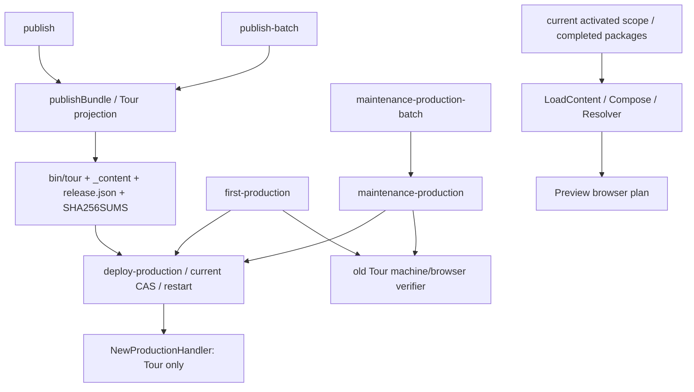

# Site v2 downstream release/deployment 跨入口审计

`RESULT=FAILED`，`STAGE=site-v2-downstream-release-path-audit`。以 2026-10-14 current working tree 为准，包含本轮开始前已存在的 WIP；不是只审计 HEAD。当前所有正式 release/deploy 入口尚未统一到 Site v2 contract。本轮完成扩大后的静态审计及离线证据复现，没有将旧入口改名或降级分类来取得 PASS，也没有实施 Production migration。

完整资料：

- [machine-readable executable inventory](RELEASE_EXECUTABLE_INVENTORY.json)：逐入口类型、状态、反向 caller、callee、输入 authority、输出、mutation、locale scope、Site/shared-assets/gate，以及 source SHA-256。
- [machine-readable audit](SITE_V2_RELEASE_PATH_AUDIT.json)：14 个模式各自的 19 项检查、7 个 identity transition、12 个阻塞项、14 条 regression requirement 的实际状态。
- [完整 FINAL 字段](SITE_V2_RELEASE_PATH_AUDIT_FINAL.txt)：exact entrypoint set、结果、文件和测试列表。

## Inventory 的发现边界与分类

先枚举所有 repository shell/Python 文件，再从 Go main dispatcher、正式 README/docs commands、Python imports、shell source/exec、Go calls、service unit 与 embedded remote stdin helpers 反向追踪。没有使用 deploy/build 名字 allowlist 作为完整性依据。inventory test 对所有 `scripts/**/*.sh`、`scripts/**/*.py` 和每个 Markdown script reference 检查分类及解析；未知入口不能静默略过。当前未发现 Makefile/task wrapper、CI release workflow、Docker deployment 或独立 service unit file；unit/vhost 来自 first-production Python 模板与 runbook commands。

Inventory 的 count 包括实际脚本、Go CLI/runtime/helper、embedded deployment helper、正式文档的 service commands 和 script tests；external OS/API 工具单独列为调用边界，不伪造为仓库脚本。不同 Python action 与普通 script launcher 分别标识，便于追踪不同 mutation gate。纯数据 schema、全部语言工作流 CLI、教学 source 中的程序、正式语言/evidence 工件和隐藏 staging 不计作 release executable。

状态含义为 `ACTIVE`、`LEGACY`、`DIAGNOSTIC_ONLY`、`TEST_ONLY`、`RETIRED`。另用 `CLASSIFICATION` 区分 CURRENT、COMPATIBILITY、LEGACY_REFERENCED、DEAD、NOT_RELEASE。**ACTIVE 不等于 Site v2 PASS。** 七个仍被引用的旧 contract 入口是 LEGACY_REFERENCED，仍保持 ACTIVE：build、publish、publish-batch、production runtime、deploy、machine verifier、production browser verifier。没有发现可安全排除的 legacy/dead executable；未删除任何入口。

shell compatibility wrappers 都转发当前 Python implementation；没有第二套 batch renderer。`internal/tour/appengine.go` 名称虽历史化，函数仍被 production 调用，不是 dead deploy helper。`tour/TRANSLATE` 的 App Engine 部署文字属于 upstream historical prose，仓库没有对应 current deployment configuration/executable，单独记录而不计 executable。standalone `tour/main.go` 与 embedded `TourOnly` 是 development/diagnostic path，不是正式 production release。

## 实际调用链与模式差异



single 与 batch 复用同一个 publish 函数，保留现有 Tour；这只能证明没有分叉 renderer，不能证明两者消费了 Site v2 authority。build 默认生成临时 Tour projection，publish 不接受其 identity，而是再次 projection/build/prerender。production binary 相对自身解析 `_content`，因此没有另一个固定旧 data root；实际缺口是该 bundle/runtime 未接 Site composition。

first-production 有专属基础设施、port/service/EnvironmentFile、Playground Origin、DNS、Surface evidence placeholder、direct-origin、readiness gates；它复用同一个 deploy、machine/browser verifier。repeat 使用 live profile 和 deploy→purge→machine→browser。first 的 shared-cloudflare freshness preflight 没有进入 repeat；不能把两者的 content/currentness contract 判为相同。

production-release-batch 的 `--all-live` 只选择 identity 中 live profile；它不是包括 first-production profile 的全 locale 部署。重复 `--locale` 是 selected live 模式；published release list 的 maintenance batch 是另一入口。没有正式 batch first-production、独立全 locale shared-assets exporter/deployer或 operator-selected historical rollback CLI。JSON 对这些边界明确记录；不存在的能力不能报告 PASS。

post-publish `--resume` 检查 clean HEAD、production identity SHA、release.json/SHA256SUMS/export manifest SHA 和顺序；`--resume-maintenance` 允许 clean HEAD mismatch，但保留生产 identity、bundle manifest、release path/order 和 assets validation。这些是有用的旧 gate；都没有绑定 activated Site coverage、structured payload、browser plan 或 locale shared-assets deployed dependency。

## 阻塞项

| ID | 实际缺口 | 直接影响 |
| --- | --- | --- |
| G01 | build/publish/runtime 只读取 Tour projection，未使用 LocalCoverage/LoadContent/Compose | single、batch、first、repeat、origin/public 均漏 current Site content |
| G02 | production 首页由 Tour `home.tmpl` 渲染；completed current Homepage/translation/structured shell 未进 release | 首页不是 current authority；不存在全入口 retirement rejection gate |
| G03 | reviewed build 不被 publish 消费；release 无 coverage/shared dependency identity；正常 upload 无 remote full-tree SHA 对照 | 无法闭合 activated→build→publish→origin→public exact identity |
| G04 | repeat 单/批无 shared freshness；已有 maintenance/shared PASS receipt 可跳过 current payload validation | 每次部署可能消费 stale/corrupt input 或历史 freshness |
| G05 | batch 缺逐 locale input SHA/prior state/mutation status；全体 phase A 后才验收 phase B | 某 locale acceptance failure 发现前，后续 locale 已修改 |
| G06 | Site assets 指向 go.dev；project export 仍旧 Tour allowlist；zh-CN same-origin consumer 未绑定 assets-go-dev | Site CSS/JS/font/image、hostname、deployed-state consumer 全链不完整 |
| G07 | Production sitemap verifier 固定旧数量、顺序和 Tour regex；runtime canonical 使用重复语言 URL registry | current Site sitemap 被拒绝或完全未构建 |
| G08 | unknown Learn/Docs path 回 Tour SPA 200；Production browser/direct-origin 未消费 Site plan | true 404、Site family/browser/asset gates 不覆盖 |
| G09 | Homepage runner 初始化请求 `/doc/play/hello.go`，composition 不注册该 auxiliary input | 正式 preview/browser 阶段仍有已复现 runtime blocker |
| G10 | IndexNow 只校验公网 sitemap host/unique/root/key，无 current activated exact-set | 可以提交 stale 或未覆盖同 host URLs |
| G11 | locale purge/receipt interruption 无 durable attempted/unknown identity；batch resume与single不同 | 完整 retry idempotence 不能证明 |
| G12 | rollback 恢复旧 locale tree，但没有完整 Site/shared-assets predecessor；global assets in-place更新 | 全 route+assets recovery/partial-tree contract 未满足 |

这些是本轮未解决的真实 code/fixture evidence；维护者没有明确暂缓，故不写入 Deferred Issues，也不声称任务 future enhancement 已被批准。各 finding 的 source symbol、证据和既有实现内的修复要求见 JSON。

### assets-go-dev 独立 release chain

`assets export` → `assets validate` → exact tree/SHA256SUMS → deploy-shared-assets staging/permissions/backup → bounded origin rsync → v1/v2 receipt → production-cdn exact changed-URL purge → public SHA/cache/boundary verifier。这条链确实存在，deploy 脚本自身没有 locale allowlist。batch 调用同一个全局 shared workflow，不存在另一个 assets batch renderer。

当前 export 的 exact static authority 来自 `internal/assets.SharedPaths`；current repository bytes validation 可拒绝自行重算 checksum 的 stale export。它没有纳入 current Site shell 使用的 CSS/JS/font/image dependency derivation；localized structured YAML 是另外的 completed package input，不能把 static export PASS 当 structured content PASS。

zh-CN 当前 production profile 仍为 `same-origin`，Tour asset URL helper 保留 locale condition；first freshness 和仅 zh-CN 的 release batch 因 profile 跳过 shared dependency，Production browser只对 shared-cloudflare profile检查资源请求的存在。Site renderer 的资源链接则使用 go.dev，未绑定这两种 policy。**ZH_CN_ASSETS_GO_DEV_COMPLETE=no**；本轮未修改正式 production identity或以 hardcode 强制迁移。

新 deploy 的 validation/receipt/purge/boundary gate 有效；但已有 wrapper verification PASS 不重验 payload/live state。locale bundle/receipt 也没有绑定被依赖的 deployed asset identity。shared 公网 verifier 未验证 current Site 新资源的 CORS/CSP/font/image policy、zh-CN hostname exact request set；没有联网 evidence可以声明这些 gate正确。partial/unknown mutation不因 static allowlist digest相同而通过。

### Artifact/service/rollback 边界

语言 deploy 不临时 renderer、不从旧 bundle 自动 fallback。它将所给目录 rsync 到 staging、整体 rename、CAS current predecessor、原子 switch symlink，然后 restart/health；binary解析自身所在 release的内容。现有 initial/local checksum只验证 manifest列出的文件，未保证安全路径或完整 actual file set；normal remote staging未对照先前记录的 local tree SHA。ALREADY_CURRENT 分支反而有 exact tree comparison和no-lock/health检查。public machine verifier只证明路径/service/HTTP，不证明运行PID executable和完整 payload SHA。

language health failure 会切回整个旧 release并 restart，明确失败但旧 healthy时不报成功；不确定状态保留锁和现场。first没有旧release，exit22保留现场；专属recovery只接受当前失败receipt和精确current，late health还检查PID executable。它不是通用rollback。global shared-assets使用完整备份和自身rollback，但in-place rsync期间可出现partial tree，且它与locale release不是一个 predecessor identity。这里不能凭已有binary/tree恢复认定完整Site+assets rollback PASS。

### Batch failure、重试与 search

batch 在 local/CDN preflight后串行phase A deploy/purge，全部完成才phase B machine/browser。mock failure证明它停止后续mutation，summary保留MUTATION_FAILED/BLOCKED/PENDING_ACCEPTANCE，未混为整体PASS。仍缺每locale独立exact输入/旧状态/明确mutation status；phase B failure无法阻止已经发生的后续locale phase A。原始receipt只绑定name/locale/hostname等；同目录payload改变后完整PASS依然直接消费。batch passed-deploy resume也没有single重新调用deploy的no-mutation current证明。

shared exact-URL purge有持久化ATTEMPTED与unknown拒绝重复POST；locale hostname purge没有同等跨orchestrator receipt的绑定，尤其成功后receipt写入失败可能重复调用。不能以成功skip已有阶段代替完整idempotence。

IndexNow动态读取sitemap，无旧固定URL count，但没有coverage/canonical/release exact-set比较；loopback fixture复现root-only stale和unactivated URL均被接受。Google/Bing/locale-specific engine是manualDashboard收口，仓库没有独立submission/verifier；batch search也不存在。未访问dashboard、未provision key/vhost、未提交任何搜索请求。

## 离线 targeted tests 与最终边界

新增 Go audit tests比较当前scope/browser plan与发布prerender source，复现route omissions、旧首页、未知Site路径200；检查source-renderedSite资源不在project export；loopbackGET复现IndexNow不绑定coverage。新增Python tests枚举全部脚本、验证docs callsites/反向图/source SHA、wrapper转发、mode/regression报告完整性，并用mock复现repeat freshness、historicalPASS、same-origin exclusion和batchfailure。不运行formalpublish或productionbinarybuild。

测试成功只意味着FAILED audit证据与inventory可复现。14条要求中只有保留Tour和wrapper转发可以给局部PASS；其他FAILED/PARTIAL明确记录，**不能替代用户要求的14条正向release regression**。修复现有release adapters后必须将这些gap reproducers替换为正向cross-entrypointtests；不能一直用“缺口仍存在”的绿灯阻塞测试充当release验收。

执行命令：

```sh
go test -mod=readonly ./cmd/tour-i18n -run '^TestReleaseAudit' -count=1 -v
PYTHONDONTWRITEBYTECODE=1 python3 scripts/release-path-audit-test.py -v
git diff --check
```

本轮没有deploy、assets真实更新、systemctl/remotehost/CDN/DNSmutation、searchsubmission、first-productionapply、formalautomatedbrowseracceptance、publicnetworkregression、翻译/Surface/activation/evidence修改或Gitcommit。停止于 `before-formal-automated-preview-browser-acceptance`。下一步是沿现有build/publish/runtime/asset authority闭合上述release阻塞项，才重新判定本stage；不新建平行v2部署系统，不重复语言审核或重写immutableevidence。
